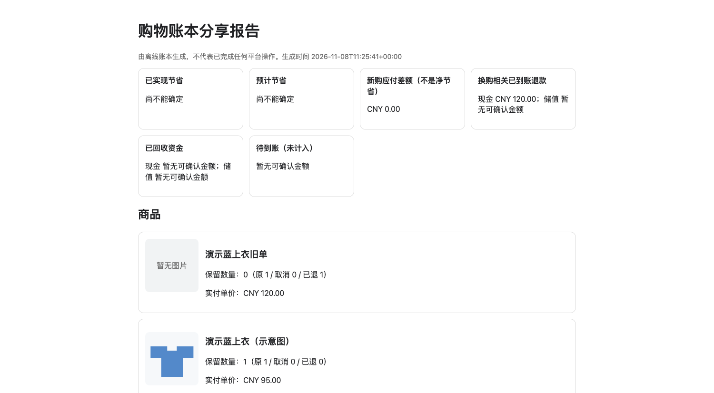

# 购物省钱与售后管家

让支持本地 Skill 的 AI 助手，基于**你自己的账号**整理购物、核对优惠与同款价格，并在你授权后协助退货、预约取件和填写真实退货运单。

**当前版本 0.1.3，实验版，可以先小范围试用；不是生产就绪的全自动购物服务。** 安装本包不会获得淘宝、京东、拼多多的账号、浏览器、支付能力或电商API。真实操作取决于你的 AI 宿主已有的工具与各平台权限。

## 能做什么

| 需求 | 本包提供的能力 | 需要另外具备什么 |
| --- | --- | --- |
| 看清买了什么、哪些重复 | 指导 Agent 核订单、实付、规格与状态 | 宿主账号读取工具，或你提供的脱敏订单 |
| 找同款更优价 | 核货号/颜色/尺码，排查会员券、消费券、凑单、支付优惠和返利 | 可访问的平台及本人登录；每条报价需现场核实 |
| 退货、取件、合包 | 授权、实际收货状态、合包许可、费用与回读的执行流程 | 宿主具备具体操作能力，平台支持，用户对应授权 |
| 填退货单号 | 真实已寄回后，核对承运商、运单及对应售后 | 已揽件证据和真实平台填写入口 |
| 清单更好读 | Python离线校验，带图HTML与手机文本摘要，逐包商品及逐方案数量 | Python 3.9+；本地账本和获准图片 |

这些购物流程是给 Agent 的操作说明，**不是随包内置的三平台自动化连接器**。离线工具不联网、不登录、不自动抓券、不会自动找到全网最优组合，也不会操作订单。

## 安装到 Codex

有 Git 的情况下，在终端运行：

```bash
git clone https://github.com/ChloeWangBot/shopping-concierge.git "$HOME/.codex/skills/shopping-concierge"
```

也可以下载仓库 ZIP，解压后将包含 `SKILL.md`、`references/`、`scripts/` 的完整文件夹命名为 `shopping-concierge`，放入你实际配置的技能目录。若已有同名目录，先备份并核对差异；不要覆盖自己的账本、报告或登录资料。重新开启一个聊天并显式调用 `$shopping-concierge`，核对宿主是否识别。

离线工具仅使用 Python 标准库，无需电商 token 或额外 Python 依赖。真实购物还需要宿主已有的官方连接器或受管浏览器；本包不会自动安装浏览器工具。其他宿主请按其官方 Skill 安装文档导入，不能从 `agents/openai.yaml` 推断兼容；**目前只给出 Codex 安装方式，未逐宿主验证**。Windows的技能发现、浏览器协作及本包完整测试尚未实测。

## 第一次怎么用

1. **先说明目标和范围。** 是比价、盘点订单，还是办理某些售后；给准确规格、配送地区、店铺要求和预算。不要一开始授权全部历史或无限购买。
2. **在本人官方页面登录所选平台。** 已有可用登录态不重复登录；不要求先登录所有平台。密码、验证码、支付验证由你完成，不发给模型。
3. **先读一两件商品，检查结果。** AI 应说明能访问哪些平台、哪些优惠已经核实、哪些尚未核实。
4. **看完清单，再按具体对象授权动作。** 比价不包含入会、注册、下单、付款、退货或客服发送授权；已有同范围授权不会反复询问，实际工具认证仍须本人完成。

可直接复制：

> 使用 $shopping-concierge。帮我查这件商品在淘宝、京东、拼多多的同款价格，颜色和尺码是……，寄上海，优先官方渠道。我会在自己的浏览器登录所选平台。把单买价、凑单总价、分摊价和预计返利分开，先不要下单、入会或联系商家。

售后示例：

> 使用 $shopping-concierge。只核对这批已申请退货的商品，按平台允许的包裹列商品、数量、收件人、地址、取件码和时间，先不要预约或更改售后。

## 怎样读比价结果

- **展示价**：搜索或商品页线索，未证明当前规格有货、账号可结算。
- **结算已核**：精确规格、数量、地区、运费和当前优惠已经核实；仍可能随时间改变。
- **凑单分摊价**：只在整组一起购买时成立；同时列整组总额及额外物品，不当作独立可买价。
- **预计返利**：需核实买家实际可得比例、跟单、退款与提现条件；推广佣金不等于买家到账。
- **已付款价**：属于这笔订单的真实成交；优惠分摊或新客资格不一定能复现给其他用户。

例如鞋单买394元，鞋加配件总付425元，鞋分摊367.16元：不需要配件的人实际多付31元，不能称省26.84元。退款、券追回、运费未确定时，不宣称已实现净节省。完整要求见 [优惠路径与核价覆盖](references/price-discovery.md)。

## 不登录也能验证离线工具

[匿名HTML演示](docs/demo.html) · [手机文本演示](docs/demo.txt)



在本包目录运行：

```bash
python3 scripts/ledger.py validate examples/anonymous-ledger.json
python3 scripts/ledger.py report examples/anonymous-ledger.json --html /tmp/shopping-demo.html --mobile /tmp/shopping-demo.txt
python3 scripts/ledger.py report examples/anonymous-ledger.json --html /tmp/shopping-public.html --mobile /tmp/shopping-public.txt --public
python3 -m unittest discover -s tests -v
```

输出位置可换成你自己的目录。样例是虚构数据，图片是几何服装示意；运行通过只证明本地校验/报告行为，不证明电商账号已接通。真实输入格式、数量约定和命令见 [离线账本](references/offline-ledger.md)。

## 隐私、授权与多人使用

每人独立安装，使用本人账号、私有目录和账本；不支持共享账号、多租户SaaS或同一账本多人并发写入。真实数据放在技能目录外，如 `~/shopping-data/平台-批次/`，不要提交到本仓库或公开Issue。

私密HTML/文本可能含订单号、收件人、地址和运单。`--public`使用白名单字段、匿名商品名与明确批准公开的图片，但仍可能展示消费金额；公开前本人审阅，CLI诊断也不能当脱敏报告。没有确认可公开的图片，不勾选 `public_image`。本地浏览器操作不等于所有数据只在本机，AI模型与工具的数据处理边界仍取决于宿主。

自动发现 Skill 仅表示加载这些说明，**不授予任何交易或账号权限**。本包不内置推荐分佣，不绑定维护者邀请码或返利账号。无返利但最终更便宜的方案应照样优先。

## 验证状态与已知限制

| 范围 | 当前结论 |
| --- | --- |
| 离线校验和报告 | 有源码、匿名样例与回归测试；验证记录见 [发布评估](docs/release-readiness.md) |
| 真实购物流程 | 有维护者本机使用经验，不等于新用户账号验收 |
| 独立用户完整闭环 | **未完成**；按 [独立账号验收](references/acceptance.md)从一两件开始 |
| 海外真实平台执行 | **已验证国家站点为零**；仅有逐站核验说明，不宣称支持自动执行 |
| 其他宿主、Windows与共享并发 | 未完成实际验收；共享并发不在支持范围 |
| 全网最低、固定省钱金额 | 不作保证，尤其不能承诺“安装后必省999元” |

平台页面、库存、优惠、跟单规则会变化，需每次核对。包裹合包还取决于平台许可、完整地址与仓库要求，同店或同快递员都不足以证明可合包。退款成功与到账是两个状态，取件码与真实运单号也不同。

## 许可证

本包原创内容按 [MIT License](LICENSE)提供。它不授予电商平台账号访问权，也不替代平台条款或宿主权限。未包含任何第三方电商连接器、浏览器程序、真实账号、凭证或私人订单。
